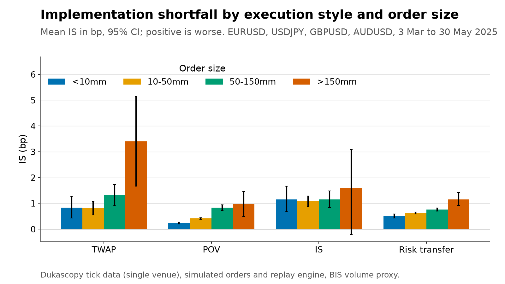

# Module 2: spot FX TCA on public tick data with an algo replay engine

Simulated institutional orders are replayed against real Dukascopy quotes for EURUSD, USDJPY,
GBPUSD and AUDUSD from 3 March to 30 May 2025. The engine models its own market impact, last look at
the liquidity providers, passive fills and an algo wheel with planted broker effects. A TCA layer
measures implementation shortfall, decomposes it so that the parts sum, scores the liquidity
providers and checks a pre-trade cost model against what was realised.

The quotes are public; every order, fill and cost is simulated by code in this repository.

## 30-second view

4,467 simulated parent orders across EURUSD, USDJPY, GBPUSD and AUDUSD, 3 March to 30 May 2025
(63 business days), replayed tick by tick against 308 pair-days of Dukascopy quotes. 99.98% of
parents fill in full. Implementation shortfall (bp of the arrival mid, positive is worse for the
client):

| Style | n | Mean IS bp | 95% CI |
|---|---|---|---|
| TWAP | 1,558 | +1.05 | [+0.84, +1.25] |
| POV | 1,558 | +0.51 | [+0.47, +0.55] |
| IS (front-loaded) | 593 | +1.12 | [+0.96, +1.28] |
| RISK_TRANSFER | 281 | +0.67 | [+0.63, +0.70] |
| FIX_ORDER | 477 | +0.01 | [−1.41, +1.32] |

Cost rises with size (FIX_ORDER excluded; its IS swings with market drift to the fix window and is shown separately): +0.63 bp below 10mm, +0.68 bp at 10–50mm, +1.07 bp at 50–150mm, +1.98 bp above 150mm. The fitted exponent of size (binned means, bootstrap 95% CI) is poorly identified from this sample: AUDUSD 1.52 [0.54, 3.00], EURUSD 0.28 [0.01, 3.00], GBPUSD 0.54 [0.01, 3.00], USDJPY 2.35 [0.09, 3.00]; the intervals span almost the entire bound. The planted broker effects are visible: broker D's mean `impact_state_bp` at fill is +1.39 bp versus broker B's +0.17 bp, and D's parent IS is +1.49 bp versus B's +0.65 bp. Leakage, not adverse selection, drives D's cost.



Sign conventions used on every figure and in every table:

- **Costs are positive when execution is worse for the client** than the benchmark.
- **A positive markout means the market moved in the trader's favour after the fill.** Many desks
  use the opposite sign; the sign here is the one in `tca.core.conventions`.

## What it does

1. `tca fx fetch-ticks` downloads hourly tick files, resumable per hour, or reads files already on
   disk with `--from-dir`.
2. `tca fx bars` and `tca fx profile` turn ticks into one-minute bars and a liquidity profile by pair
   and five-minute bucket of UTC time of day, with a flag for the WM/R window.
3. `tca fx simulate` generates parent orders and replays them tick by tick (section "Replay engine").
4. `tca fx tca` computes fill-level and parent-level costs and the liquidity-provider scorecard.
5. `tca fx figures` draws the seven figures; `tca fx summary` prints the numbers the findings are
   written from.

`tca fx data` runs the download, the bars and the profile in one go. `--profile ci` runs any command
on the synthetic fixture and three simulated days (at most the days the fixture holds), writing under
`data/ci/`, so it never touches the committed outputs.

### Client flow

Per weekday `Poisson(70)` parent orders across the four pairs (weights 0.45, 0.25, 0.18, 0.12), with
a London-morning-heavy arrival mixture, lognormal notionals (median 25mm USD, clipped to 1mm to
750mm) and a daily buy bias. Each parent has an urgency that selects its style:

| Urgency | Style | Schedule |
|---|---|---|
| LOW | `TWAP` | `clip(notional_mm / 5, 10, 120)` minutes, slices every 30 to 90 s, each tries passive first for 20 s |
| MEDIUM | `POV` | 20% of the volume proxy, at most 90 minutes, aggressive |
| HIGH | `IS` | Almgren-Chriss trajectory, `clip(notional_mm / 15, 3, 30)` minutes |
| HIGH (30%) | `RISK_TRANSFER` | one principal fill at `mid ± (hs × 1.2 + k_rt × sqrt(Q / V))` |
| FIX | `FIX_ORDER` | TWAP over the WM/R window, an aggressive child every 5 s |

Orders that are neither risk transfer nor fix go through the algo wheel: 70% are assigned to one of
brokers A to D uniformly at random, 30% by a rule that sends notional over 100mm to broker A and the
rest uniformly.

### Replay engine

Deterministic given the seed. For each parent the engine walks the raw ticks from arrival to
completion (`tca/fx/replay.py`).

- **Effective market.** `mid_eff(t) = mid_tape(t) + impact_state(t)`. Each fill of `q` USD adds
  `side × Y × sigma_d × mid × (sqrt((Q_cum + q) / V) - sqrt(Q_cum / V))` to the state, half
  permanent and half decaying with a 15 minute half-life (`tca.core.impact.ImpactState`).
  `sigma_d` is the trailing 20-day realised daily volatility from the one-minute bars. Algos see
  `bid_eff = bid_tape + impact_state` and `ask_eff = ask_tape + impact_state`.
- **Liquidity providers and last look.** Five LPs with a markup against the tape touch, a base
  rejection probability, an extra rejection probability when the tape mid moved against the LP
  during its hold time (`reject_asym`), a lognormal hold time and a maximum clip. An aggressive
  child goes to the best quote with capacity; a rejection sends it to the next; after three
  rejections it crosses an ECN at `ask_eff + 0.1` pip. Every attempt is recorded.
- **Passive children.** A buy rests at `bid_eff`. It fills when the effective ask falls to the limit
  or below; otherwise at a hazard `lambda_fill` per second while the tape bid sits at the limit,
  calibrated so that about 40% of passive children fill; otherwise it times out and the child goes
  aggressive. The realised passive fill rate is 49.8%. The ~40% target is not reachable through
  `lambda_fill` because crossing alone (with `lambda_fill = 0`) fills about 46% of passive children
  on the full sample (4,467 orders; 46.4% at `lambda_fill = 0`): on EURUSD (52.1%) and USDJPY
  (55.4%) the crossing rate already exceeds 40%, GBPUSD is at 39.1% and AUDUSD at 13.2%, so
  the calibrator returns `lambda_fill = 0` for every pair except AUDUSD. The model has no queue or
  priority, so a resting order fills at first touch when the tape spread is sub-pip. The effect of
  moving from 49.8% to 40% depends on the lever. A crossing haircut that reaches 40% raises TWAP
  IS by about 0.06 bp (+0.059, se 0.006). Both fill rates replicate over master seeds
  (`scripts/fx_fill_rate_seeds.py`, `docs/tables/fx_fill_rate_seeds.csv`, six seeds): crossing
  alone fills 45.0% to 46.9% and the calibrated run 48.2% to 50.1%, and a haircut solved to a 40%
  pooled rate raises TWAP IS in every seed, by 0.054 to 0.081 bp (mean 0.061, paired standard
  error 0.006 or less). The timeout lever was measured on the configured seed only, where it
  lowers TWAP IS by 0.03 to 0.07 bp. Passive fills accrue impact at half the aggressive
  coefficient.
- **Latency.** Every child's decision time is 20 ms after the tick it acts on.
- **Fill price.** An aggressive buy fills at `ask_eff + lp_markup + broker_markup` at the acted-on
  tick, a passive buy at its limit; sells mirror this. Impact moves quotes away from the tape and
  markups can be negative, so a fill can sit inside the tape touch.
- **Fix proxy.** The fix benchmark of a day is the median of the one-second tape mids across the
  WM/R window (15:57:30 to 16:02:30 London time). The official methodology uses trade and order
  snapshots; this is a proxy.

The engine is a library. `tca.fx.simulate.run(cfg, seed, source, market, overrides)` accepts an
explicit order list, a forced broker, a restricted set of days, a fixed passive hazard and extra
execution strategies by style name:

```python
from tca.fx.simulate import Overrides, run
from tca.fx.strategies import register_strategy


@register_strategy("MY_STYLE")
class MyStyle:
    def planned_duration_s(self, order, ctx): ...
    def schedule(self, order, ctx, rng): ...  # list of ChildPlan(offset_s, qty_usd, intent)


result = run(cfg, seed, source, market, Overrides(orders=my_orders))
```

### Pre-trade estimate

`est_bp = hs_bp(pair, tod) × f_style + Y × sigma_d_bp × sqrt(Q / V) × g(T)`, where `hs_bp` is the
median half spread of the arrival bucket, `f_style` is 1.0 for aggressive, 0.5 for TWAP and 1.2 for
risk transfer, and `g(T) = (30 min / T)^0.25` clipped to `[0.5, 2]`. It is computed before the replay
and is not fitted to the realised costs. Figure 6 and the bias and RMSE by style compare it with the
realised shortfall. FIX_ORDER pre-trade RMSE is 15.2 bp, which is almost entirely market drift from
arrival to the fix window; the pre-trade formula does not forecast this drift. Against `fix_bench_bp`
(the cost versus the fix proxy) the RMSE is about 0.70 bp.

## Data and calibration

### Ticks

Dukascopy Bank SA historical tick feed (bid, ask, indicative volumes) for EURUSD, USDJPY, GBPUSD and
AUDUSD, 3 March to 30 May 2025 (63 business days, from the trading calendar). Dukascopy data is for
personal, non-commercial use and may not be redistributed in bulk. **Raw ticks are never committed
to this repository and are not redistributed in any form.** What is committed is derived: the
liquidity profile, and simulated orders, fills and costs in basis points, with attribution to Dukascopy.
Tables and columns that hold price levels directly (one-minute bars, fill prices and tape quotes) are not committed; see "Schema". Price levels can still be derived from the published cost columns, for example the pips and bp pair in `fx_tca_fill`, so this is an omission and not a protection.
Anyone re-running the download accepts Dukascopy's terms themselves. Dukascopy volumes are a single
venue and are stored but never used as ADV or as the participation denominator.

Access policy of the downloader: an honest `User-Agent` (`tca-stack-research/0.1`), one request at a
time, at most one per second, no proxies, no IP rotation. On HTTP 403, 429 or a persistent 5xx it
backs off (60 s, doubling, four tries), then stops, keeps what is cached and exits with code 3. It
does not work around a block. `tca fx fetch-ticks --from-dir <folder>` reads already-downloaded
`.bi5` files laid out as `{PAIR}/{YYYY}/{MM}/{DD}/{HH}h_ticks.bi5` (zero-based month) through the same
parser and makes no network request.

The test fixture `tests/fixtures/fx_ticks_synthetic_2d.parquet` is **synthetic**: a Brownian mid with
a time-of-day spread and tick-rate shape taken from the defaults in the `synthetic` section of
`config/fx_sim.yaml`. It does not copy the measured liquidity profile, which does not exist before the
real ticks are processed. It exists so that tests and the `ci` profile run without a download.

### Volume proxy

FX has no consolidated volume. The simulator participates against a daily spot-turnover proxy `V` per
pair, allocated across the day by the pair's tick-rate profile. This is a modelling convenience.

| Pair | Spot turnover `V` (USD bn / day) | Status |
|---|---|---|
| EURUSD | 626.6 | DERIVED |
| USDJPY | 422.8 | DERIVED |
| GBPUSD | 240.8 | DERIVED |
| AUDUSD | 225.3 | DERIVED |

Source: BIS Triennial Central Bank Survey 2025, April 2025 daily averages. Global spot turnover is
2,957.1 USD bn / day (READ); BIS publishes turnover by currency pair across all instruments, not spot
by pair, so each pair's spot is the global spot times its share of all-instrument turnover (DERIVED).
Full register with the cells read: `docs/fx_calibration.md`.

### Liquidity providers

Attributes are drawn once per seed in the ranges below (`config/fx_sim.yaml`, `fx_lps` holds the
realised draws). All are assumptions taken from the module specification.

| Attribute | Range |
|---|---|
| `markup_pips` against the tape touch | -0.05 to +0.15, uniform |
| `reject_base` | 0.01 to 0.08, uniform |
| `reject_asym` | 0 to 0.25, uniform |
| hold time | lognormal, median 30 to 250 ms, sigma 0.5 |
| `max_clip_mm` | 50, 40, 30, 20, 10 |

### Brokers (the planted effects)

These are the ground truth of the algo wheel. They are disclosed here openly, and an analysis of the wheel tests
whether a regression on realised costs recovers them. They live in `config/brokers.yaml` and in no
code.

| Broker | Planted effect |
|---|---|
| A | fill markup -0.15 bp (better), impact coefficient 1.3× (worse on large orders) |
| B | fill markup +0.20 bp (worse), impact 1.0× |
| C | fill markup -0.10 bp from 07:00 to 12:00 UTC, +0.25 bp otherwise |
| D | markup -0.25 bp (best spread), but its liquidity providers pre-hedge and signal: each fill adds an extra 0.3 bp of permanent same-direction impact to the effective mid |

D therefore looks best on spread cost and on per-fill markouts, and worst on parent implementation
shortfall for multi-child orders. Its defect is **leakage, not adverse selection**. Adverse selection
lives at the liquidity-provider layer, through asymmetric last look, and is reported in pips in the LP
scorecard at its realistic size. The two have different signatures: leakage shows as positive fill
markouts and bad parent shortfall; asymmetric last look shows as negative short-horizon markouts and a
cost of rejection.

The 0.3 bp is added after every fill, so the cumulative leakage of a parent grows with its child
count. See Known limitations.

## Metric definitions

`side` is +1 for a buy of the base currency and -1 for a sell. Prices are mids unless stated.
`pip_size` is 0.0001, or 0.01 for JPY-quoted pairs.

**Fill level** (`fx_tca_fill`)

- `spread_cost_bp = side × (px - mid_tape_at_fill) / mid_tape_at_fill × 1e4`, positive is worse;
  `spread_cost_pips` the same in pips.
- `effective_spread_bp = 2 × |px - mid_tape_at_fill| / mid_tape_at_fill × 1e4`.
- `realised_spread_bp_5 = -2 × markout_eff_bp_5`.
- **Markouts.** `markout_bp(h) = side × (mid(t_fill + h) - px) / px × 1e4`. **A positive markout
  means the market moved in the trader's favour after the fill.** Two families are stored, one row
  per fill in `fx_markouts`, wide, with the horizon `<h>` in seconds (0, 1, 5, 30, 60, 300, 900,
  1800, 3600):
  - `markout_tape_bp_<h>` measures against the historical tape mid. It contains market noise only.
  - `markout_eff_bp_<h>` measures against the effective mid, tape plus `impact_state`. It contains
    the order's own footprint, including broker D's leakage. Figures and LP scorecards use this one.

  Leakage and impact push the price in the direction of the trade, so a fill's effective markout
  goes up while later fills of the same order get worse.

**Parent level** (`fx_tca_parent`). `D` is the tape mid at arrival (the decision mid), `m0` the tape
mid at the first child's decision, `q_i` the fill sizes, `Q_f = Σ q_i` the filled quantity, `Q` the
parent quantity and `x = Q_f / Q`. Every term is in bp of `D` and positive when worse:

```
delay_bp    = Σ (q_i / Q_f) × side × (m0 - D)               / D × 1e4
spread_bp   = Σ (q_i / Q_f) × side × (px_i - mid_eff_i)      / D × 1e4
impact_bp   = Σ (q_i / Q_f) × side × (mid_eff_i - mid_tape_i) / D × 1e4
timing_bp   = Σ (q_i / Q_f) × side × (mid_tape_i - m0)       / D × 1e4

is_filled_bp = side × (avg_fill_px - D) / D × 1e4 = delay + spread + impact + timing
opportunity_bp = (1 - x) × side × (end_mid - D) / D × 1e4
is_bp = x × is_filled_bp + opportunity_bp
```

Both identities are tested to 1e-9. In plain terms: `is_bp = x × (delay + spread + impact + timing) + opportunity`, where `x` is the filled fraction. `is_bp` is the column every figure uses. Figure 3 stacks
`x × delay`, `x × spread`, `x × impact`, `x × timing` and `opportunity`, which sum to `is_bp`.

Further columns: `twap_bench_bp` (average fill against the tape mid time-weighted over the planned
window), `cost_vs_interval_twap_bp` (average fill against the time-weighted *effective* mid from the
first child's decision to the last fill, in bp of that benchmark), `fix_bench_bp` (fix orders, against
the fix proxy), `reversion_30m_bp` (quantity-weighted change of the effective markout from the fill to
30 minutes), `pct_passive_filled`, `reject_rate`, `n_lps_used`, `n_fills`, `mean_impact_state_bp` (the
quantity-weighted effective-mid offset at the fills in the trade direction, in bp of the tape mid,
the noise-free measure of footprint and leakage) and `pretrade_est_bp`.

The interval benchmark is observable and has far less noise than arrival-based shortfall, but it
moves with the order's own impact, so it cannot see a broker's leakage; only arrival-based shortfall
on multi-child orders can.

**Liquidity-provider scorecard** (`fx_lp_scorecard`, per LP, pair and month). Share of attempts, fill
ratio, reject ratio, `asym_reject` (rejection rate when the tape mid moved against the LP during the
hold, minus the rate when it did not), median hold time, average markup, `markout_eff_pips_1` and
`markout_eff_pips_30` (mean effective markout of the LP's fills in pips) and `cost_of_rejection_bp` and
`_pips` (how much worse the eventual fill of the child was than the rejected quote). The ECN fallback
is not an LP and is excluded.

## Schema

| Table | Grain | Key columns |
|---|---|---|
| `fx_liquidity_profile` | pair × weekday (`-1` = all) × 5-minute UTC bucket | median and 90th percentile spread in pips and bp, `tick_rate_per_s`, `realised_vol_ann`, `n_days`, `wmr_share`, `wmr_window` |
| `fx_lps` | LP | `markup_pips`, `reject_base`, `reject_asym`, `hold_median_ms`, `hold_sigma`, `max_clip_usd` |
| `fx_orders` | parent | `order_id`, `pair`, `side`, `notional_usd`, `ts_arrival_utc`, `urgency`, `style`, `broker`, `assignment`, `trader_id`, `planned_duration_s`, `pretrade_est_bp`, (the benchmark mid columns are not published) |
| `fx_children` | child | `child_id`, `order_id`, `ts_decision_utc`, `qty_usd`, `intent`, `tick_utc`, `impact_state`, `origin_child_id` |
| `fx_fill_attempts` | LP attempt | `child_id`, `lp_id`, `ts_sent_utc`, `hold_ms`, `outcome` (`FILLED`, `REJECTED`, `ECN`), `moved_against` |
| `fx_fills` | fill | `fill_id`, `child_id`, `order_id`, `lp_id`, `intent`, `ts_fill_utc`, `qty_usd`, `impact_state_at_fill`, `n_rejects` |
| `fx_markouts` | fill (wide) | `fill_id`, `markout_tape_bp_<h>`, `markout_eff_bp_<h>` |
| `fx_tca_fill` | fill | cost and markout columns above |
| `fx_tca_parent` | parent | decomposition and benchmark columns above |
| `fx_lp_scorecard` | LP × pair × month | scorecard columns above |

`lp_id` is 1 to 5 for an LP, `0` for the ECN, `-1` for the principal of a risk-transfer order and `-2`
for a resting passive order. Timestamps are UTC at microsecond precision. Floats are rounded before
storage (prices to 1e-6, bp and pips to 1e-4).

**Published and private tables.** The published `data/derived` holds cost tables in basis points and pips. `fx_bars_1m`, the
tape and fill price columns (`px`, `mid_*`, `bid_tape`, `ask_tape`, `limit_px`, `quoted_px`, `lp_markup_px`,
`broker_markup_px`, `px_tick_utc`) and the benchmark and average-fill price columns of `fx_orders` and
`fx_tca_parent` are not committed, so `tca fx tca` and `tca fx figures` cannot be re-run from the
published tables alone. The levels themselves can be derived from the published cost columns. To re-run the chain, start from your own tick download. A table above 100,000 rows is written as
`<table>/part-*.parquet` so that no file nears the 25 MB limit; `tca db build` reads both forms.

## Figures

| File | Content |
|---|---|
| `fx_01_is_by_style_size.png` | Hero. Mean IS by style and size bucket, 95% bootstrap CI |
| `fx_02_liquidity_heatmap.png` | Median quoted spread in bp by pair and UTC hour, sessions and fix window marked |
| `fx_03_is_decomposition.png` | Stacked contributions of delay, spread, impact, timing and opportunity by style |
| `fx_04_cost_vs_size.png` | IS against notional per pair, log x-axis, fitted `a + b × size^c` with the exponent printed |
| `fx_05_lp_scorecard.png` | LP heatmap with raw numbers in the cells; adverse selection in pips |
| `fx_06_pretrade_calibration.png` | Realised IS against the pre-trade estimate with bias and RMSE by style |
| `fx_07_markouts_by_lp.png` | Effective markout curves from 0 to 60 minutes by LP, aggressive fills |

Positive IS is worse. Positive markouts are better for the trader.

## How to run

```bash
uv sync
uv run tca fx data                 # download ticks (resumable), then bars and profile
uv run tca fx simulate             # orders and replay, seed from config/fx_sim.yaml
uv run tca fx tca
uv run tca fx figures
uv run tca fx summary              # the numbers the findings are written from
uv run python scripts/fx_fill_rate_seeds.py   # six seeds, the fill-rate ranges quoted above
```

The download is about 6,000 hourly files at one request per second. Run it detached; it resumes per
hour. To use files you already hold, `uv run tca fx fetch-ticks --from-dir <folder>`. To try the whole
chain without any download, add `--profile ci` to each command (synthetic ticks, written under
`data/ci/`). Raw ticks are read from `$TCA_DATA_RAW/fx/{pair}/{date}.parquet`.

Run time, measured on one core with synthetic days of 200,000 ticks per pair (the real volume): the
replay takes about 1.9 s per simulated day, so the 63-day simulation takes about two minutes; bars
for all pairs and days take well under a minute. The download dominates the wall time.

## Known limitations

- **Single-venue tape.** Dukascopy quotes are one venue's view of a fragmented market, and the
  indicative volumes are not used.
- **Impact coefficient borrowed from equities.** `Y = 0.7` comes from the equity literature
  (Tóth et al. 2011; Bucci et al. 2019). No FX estimate is claimed, and the 15 minute half-life and
  the 50% permanent share are design choices.
- **No consolidated volume.** `V` is a BIS turnover proxy allocated by tick rate. POV participation
  is measured against it.
- **The fix benchmark is a proxy** built from one-second quote mids, not the official WM/R snapshots.
- **Spot only.** No forwards, swap points or value-date effects.
- **The simulated client is not a real client.** Order flow, urgency mix, broker assignment and the
  planted broker effects are assumptions, and every result is conditional on them.
- **Broker D's leakage scales with child count.** The specification adds 0.3 bp of permanent impact
  after every fill, so a POV order with hundreds of children accumulates far more leakage than a
  five-child TWAP. The size is configurable (`post_fill_impact_bp` in `config/brokers.yaml`).
- **Last look sees only the tape.** An LP rejects based on whether the tape mid moved against it
  during the hold; it does not see the order's own footprint.
- **Calibration of the passive fill hazard** targets 40% on the first days of the sample and is then
  held fixed.
