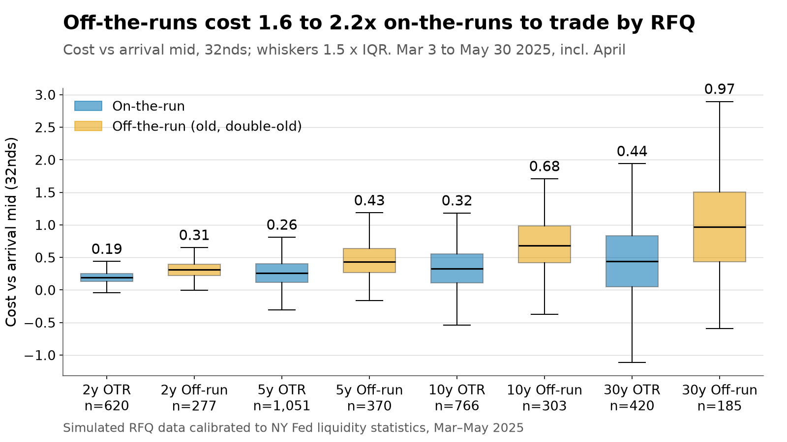
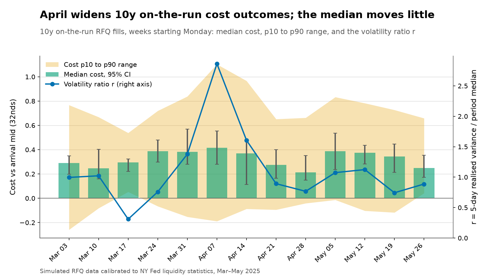
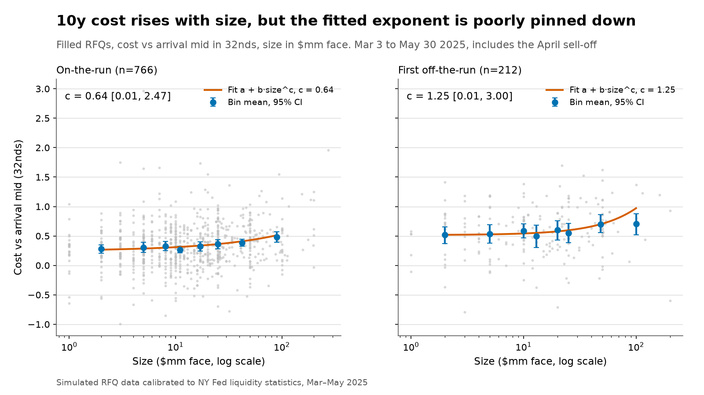
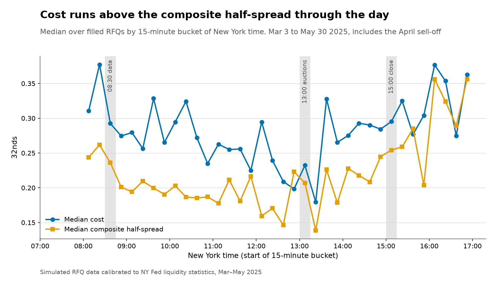
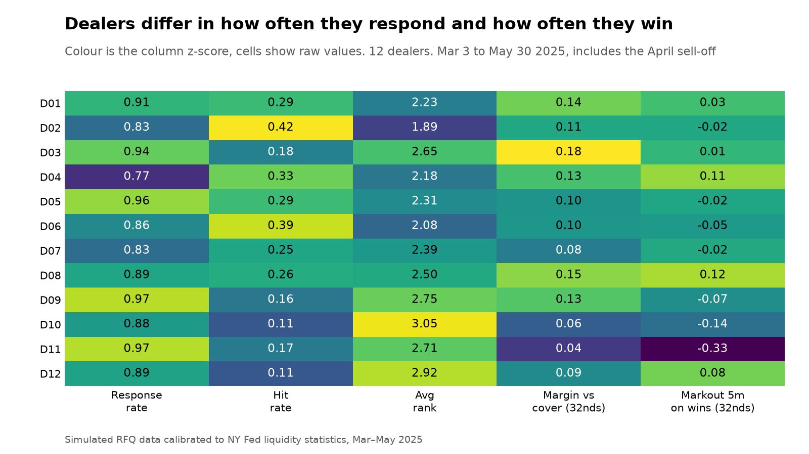
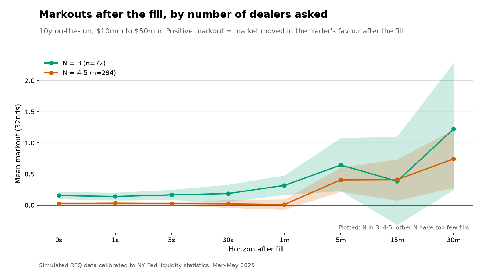
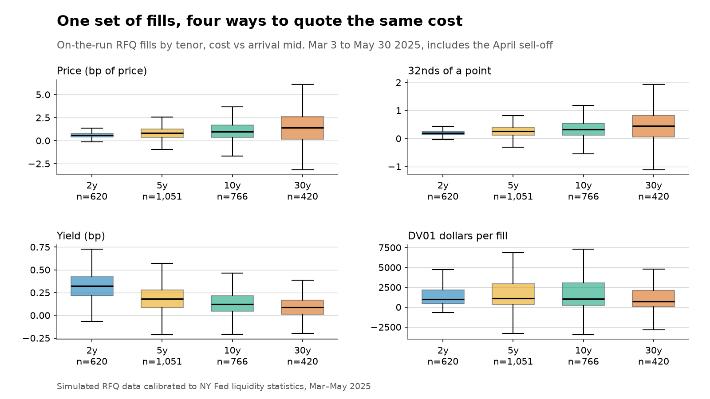
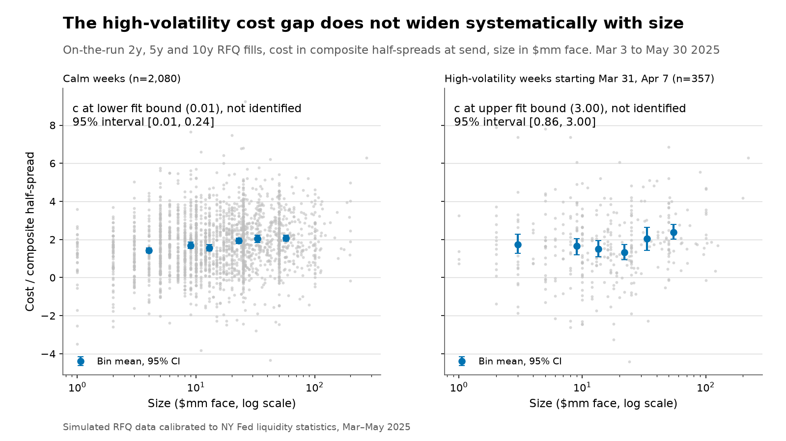

# Module 1: UST dealer-to-client RFQ TCA

A transaction cost analysis engine for US Treasuries traded by request for quote (RFQ), run on a calibrated
market simulator. There is no public intraday Treasury tape, so the market and the order flow are simulated;
every simulator parameter is tied to a public number or labelled as an assumption in `config/ust_sim.yaml`.
Everything below was computed from the simulated tables. All data is public or simulated. The published
`data/derived` keeps the cost, count and basis-point tables; the raw simulated level columns are not committed
(see Schema).

## 30-second view



Cost is measured against the arrival mid in 32nds of a point, positive when the fill is worse than the
benchmark. Period: 2025-03-03 to 2025-05-30, which includes the April 2025 sell-off. 5,414 filled RFQs from
4,309 parent orders.

- **Off-the-runs cost 1.6 to 2.2 times on-the-runs by RFQ (median cost, 2y to 30y), by construction.** 10y mean cost is 0.337 (95% CI 0.309 to 0.364) on the run,
  0.589 (0.531 to 0.643) for the first off-the-run and 0.932 (0.835 to 1.034) for the second. The ratio is the
  simulator's own input (`run_mult` 1 / 2.5 / 4, an assumption on the half-spread), so this reproduces the
  assumption through quote competition; it is not evidence about the real market.
- **April widens the range of outcomes and lifts parent shortfall; the size split does not show impact.** For 10y on-the-run fills, the week of 2025-04-07 against the mean of the other twelve weeks:
  median cost 0.416 against 0.318 (32nds), mean 0.489 (95% CI 0.291 to 0.702) against 0.329, p10 -0.189 against
  -0.077, p90 1.103 against 0.735, and parent implementation shortfall (IS) 3.46 bp against 1.56 bp (31 parents
  that week). In words: the median moves little, both tails widen with the upper tail widening about three
  times as much as the lower, and the mean and parent IS carry the rise. A three-way split into spread (median),
  timing risk (symmetric tails) and depth and impact (mean and parent IS) is only partly supported: the tails
  are not symmetric, and the gap between high-volatility and calm weeks does not grow with ticket size (below),
  so the rise cannot be attributed to impact from this simulation.
- **Size matters, split parents cost more.** 10y on-the-run mean cost rises from 0.300 (0.258 to 0.341) for
  tickets of $10mm or less to 0.669 (0.415 to 0.918) for $100mm to $500mm. Parents split into several RFQs
  have mean IS of 1.78 bp (0.97 to 2.59) against 0.89 bp (0.79 to 0.99) for single RFQs, but the interval on
  the split parents is wide.

Markout sign: a positive markout means the market moved in the trader's favour after the fill (many desks use
the opposite sign).

## What it does

1. `tca ust data` builds four small input tables from public downloads (`tca ust fetch-anchors`): the
   securities and daily universe from TreasuryDirect, the daily par curve from the US Treasury, and an event
   calendar (NFP, CPI, FOMC, auction results).
2. `tca ust simulate` generates, for each business day, a one-second yield path for each of the day's 15
   securities (a time-changed Brownian bridge pinned to the published close, three-factor cross-section from a
   PCA of the period's daily changes, a U-shaped intraday variance clock with spikes at releases, auctions,
   FOMC and the 15:00 marks), a composite half-spread and touch depth, 12 dealers, and client order flow.
   Each RFQ goes to N dealers; the client awards to the best responder or passes; fills move the effective mid
   (square-root impact, 40% permanent, 10-minute half-life); losing dealers and the winner hedge, which
   leaks the client's direction into the market.
3. `tca ust tca` computes per-fill costs and markouts, parent-order implementation shortfall and the dealer
   scorecard.
4. `tca ust figures` draws the seven figures; `tca ust summary` prints the numbers quoted here.

The simulator is also a library: `tca.ust.simulate.run(cfg, seed, Overrides(...))` accepts
`leakage_scale`, `competition_widening_scale`, a forced `n_dealers`, an explicit RFQ list and a list of days.
Random draws for an RFQ do not depend on the number of dealers asked, so changing those overrides re-prices the
same market.

### Modelling choices worth knowing

- **Quotes are live until the award.** Every responder quotes off the effective mid at the award time.
  Latency decides who has responded by the award and when it happens. Otherwise the client would hold a free
  option on the move during the RFQ, which falls in value as volatility rises, so costs would fall when markets
  get worse. Quotes are refreshed to the award, so send-to-award drift appears as symmetric timing risk in cost
  versus the arrival mid and not as dealer pick-off; award latency is kept.
- **Quote floor.** After all terms a dealer's ask is at least `mid_eff + 0.15 * hs(t)` (bid symmetric), where
  `hs(t)` is the composite half-spread and the dealer's own spread multiplier is not applied. Axed dealers do
  quote well inside the composite touch. Asks are rounded up and bids down to 1/256.
- **Competition widening.** Each dealer adds `competition_widening` 32nds per dealer beyond three asked, drawn
  uniformly between 0 and 0.03 per dealer (an assumption with no source), scaled by
  `competition_widening_scale`.
- **Regime channels.** One volatility ratio `r = rv_5d / rv_median` of the 10y drives three multipliers:
  `spread_mult = r^e_spread`, `depth_mult = r^e_depth`, `impact_mult = r^e_impact`, each clipped. The
  elasticities are derived in code from the April 2025 readings at `r` of 2025-04-09 (3.4):
  `e_spread` 0.120, `e_depth` -0.827, `e_impact` 0.714.

The hero figure shows 2y, 5y, 10y and 30y; 3y, 7y and 20y are simulated and present in the tables but omitted
from the figure for legibility. Whiskers are 1.5 times the interquartile range and outliers are not drawn.

## April 2025

### Cost distribution and parent IS, 10y on-the-run, week of 2025-04-07 against the other twelve weeks

The figure and this table use 10y on-the-run fills only (40 fills and 31 parents in the April week), so the tenor
mix of a week cannot move the series.

| Measure | April week | Other weeks (mean of weekly values) |
|---|---|---|
| Fill cost, median (32nds) | 0.416 | 0.318 |
| Fill cost, mean (32nds) | 0.489 | 0.329 |
| Fill cost, p10 (32nds) | -0.189 | -0.077 |
| Fill cost, p90 (32nds) | 1.103 | 0.735 |
| Parent IS, median (bp) | 1.107 | 1.159 |
| Parent IS, mean (bp) | 3.455 | 1.560 |
| Parent IS, p10 / p90 (bp) | -2.990 / 9.518 | -3.137 / 6.478 |
| Realised 10y vol (bp/day) | 9.808 | 5.664 |



The April week's mean cost has a 95% bootstrap interval of 0.291 to 0.702, which contains the other weeks' mean
of 0.329: with 40 fills the week is not distinguishable on the mean. The upper tail and parent IS move most.
Pooling all tenors and run statuses (not composition-adjusted) gives the same picture with more fills: median
0.299 against 0.282, mean 0.442 (0.375 to 0.513) against 0.344, p10 -0.159 against -0.007, p90 1.229 against
0.785, parent IS 1.83 bp against 1.09 bp.

Fill-level dispersion is mostly market move. A fill's cost against the arrival mid contains a mean-zero move of
the market during the RFQ, which is risk rather than cost and grows with volatility; it explains why p10 falls
as p90 rises. The rise in the mean and in parent IS is the cost: the wider composite spread and the higher price
impact of the regime channels.

### Simulated April peak against the NY Fed readings

Spread and depth are measured from the simulated one-minute bars (not published) between 08:35 and 15:00 (daily mean, then a
centred five-day mean); impact is the configured slope times the day's impact multiplier. "Normal" is the
simulated mean before 2025-04-01. Readings are the on-the-run 2y, 5y and 10y five-day averages read from
Fleming's charts (see `docs/ust_calibration.md`).

| Tenor | Measure | Simulated peak | Reading | Simulated ratio to normal | Reading ratio to March level |
|---|---|---|---|---|---|
| 2y | Full spread (32nds) | 0.161 | 0.16 | 1.18 | 1.14 |
| 2y | Depth (mm) | 12.7 | 12 | 0.35 | 0.40 |
| 2y | Impact (32nds / $100mm) | 0.318 | 0.40 | 2.51 | 2.67 |
| 5y | Full spread (32nds) | 0.309 | 0.32 | 1.19 | 1.19 |
| 5y | Depth (mm) | 12.7 | 9 | 0.35 | 0.30 |
| 5y | Impact (32nds / $100mm) | 0.635 | 0.80 | 2.51 | 2.67 |
| 10y | Full spread (32nds) | 0.626 | 0.62 | 1.20 | 1.15 |
| 10y | Depth (mm) | 12.7 | 12 | 0.35 | 0.40 |
| 10y | Impact (32nds / $100mm) | 1.694 | 1.55 | 2.51 | 1.94 |

Spreads land within about 4% of the readings. 5y depth is 41% above its reading, outside the +-35% tolerance
in the config, and impact is 21% below at 2y and 5y and 9% above at 10y: one elasticity per channel fitted to a
geometric mean over three tenors cannot match three different ratios.

## The other figures



10y cost against size. Binned means rise with size, but the fitted `a + b size^c` is poorly pinned down: the
exponent is 0.64 [0.01, 2.47] on the run and 1.25 [0.01, 3.00] off it (binned-means fit, 95% bootstrap interval,
exponent bounded to 0.01 to 3). The point estimates are not pinned down, the intervals span nearly the whole
allowed range, and no ordering of on-the-run against off-the-run can be read from them, so the data neither
support nor rule out a square-root claim. By size bucket
(10y on-the-run, mean 32nds with 95% CI): 0.300 (0.258 to 0.341) up to $10mm, 0.319 (0.271 to 0.368) to $25mm,
0.386 (0.320 to 0.449) to $50mm, 0.435 (0.352 to 0.521) to $100mm, 0.669 (0.415 to 0.918) above.



Median cost and median composite half-spread by 15-minute bucket. Both are lowest around midday and rise
after 15:00 and after 16:00; the shaded buckets mark 08:30 data, 13:00 auction results and the 15:00 close.
Median spread capture over all fills is -36.7%: the typical fill pays more than the composite half-spread.



Pooled over the period, response rates run from 0.77 to 0.97 and hit rates from 0.11 to 0.42. The table
`ust_dealer_scorecard` adds the month and tenor bucket; `ust_dealer_effects` holds logit fixed effects for
winning, controlling for size, run status, tenor and number of dealers.



10y on-the-run, $10mm to $50mm, positive markout = the market moved in the trader's favour. The default
dealer policy never asks six or more dealers here, and N of 1 and 2 have 25 and 4 fills, so only N = 3 (72
fills) and N = 4 to 5 (294 fills) are drawn. Mean five-minute markout in 32nds: N = 3 0.643 (0.218 to 1.074),
N = 4 0.449 (0.230 to 0.661), N = 5 0.141 (-0.357 to 0.645). A markout that rises with leakage looks good
fill by fill while the information has been given away; a forced-N sweep is outside this release.



The same on-the-run fills in four units. The median 32nds cost rises with tenor (0.195 at 2y, 0.443 at 30y);
in yield bp it falls (0.323 at 2y, 0.089 at 30y); in DV01 dollars per fill (median) it ranges from $522 (20y) to $1,105 (5y) across the seven tenors, with no
monotone pattern, because ticket sizes and DV01 per million both differ by tenor. The four tenors drawn are
$982 (2y), $1,105 (5y), $1,034 (10y) and $727 (30y).

## Does the high-volatility gap grow with size?



If April's extra cost were impact, the high-volatility curve would sit above the calm curve by more at larger
sizes. High-volatility weeks are those with realised 10y vol above 7 bp/day: the weeks starting 2025-03-31 and
2025-04-07. The 10y on-the-run alone has 96 fills in those weeks and one above $100mm, which is too thin, so
the figure pools the on-the-run 2y, 5y and 10y (357 fills in the two weeks, 2,080 in the calm weeks) and
measures cost in composite half-spreads at send. Both fits hit a bound of the allowed range 0.01 to 3, so the
exponent is not identified in either sample and no estimate is stated: the calm fit is at the lower bound (95%
interval 0.01 to 0.24) and the high-volatility fit is at the upper bound (95% interval 0.86 to 3.00). The figure
labels both as at the fit bound and draws no fitted curve, only the bin means with their intervals. The gap, high-volatility minus calm mean, by size bucket
with 95% bootstrap intervals:

| Size ($mm) | Pooled, half-spreads (n high / calm) | Pooled, 32nds | 10y on-the-run, 32nds (n high / calm) |
|---|---|---|---|
| up to 10 | 0.138 (-0.203 to 0.472), 143 / 775 | 0.043 (-0.026 to 0.117) | 0.154 (-0.040 to 0.357), 44 / 298 |
| 10 to 25 | -0.402 (-0.719 to -0.100), 122 / 702 | -0.014 (-0.076 to 0.050) | 0.086 (-0.079 to 0.271), 32 / 204 |
| 25 to 50 | 0.109 (-0.350 to 0.558), 58 / 398 | 0.051 (-0.023 to 0.125) | 0.028 (-0.189 to 0.244), 12 / 97 |
| 50 to 100 | 0.402 (-0.160 to 0.973), 28 / 172 | 0.081 (-0.017 to 0.182) | 0.042 (-0.189 to 0.299), 7 / 56 |
| 100 to 500 | 0.274 (-1.256 to 1.945), 6 / 33 | 0.030 (-0.373 to 0.499) | too few (1 fill) |

Verdict: the diagnostic does not show the gap widening with size. In the 10y on-the-run the gap is largest in
the smallest bucket and shrinks, with every interval containing zero. In the pooled half-spread measure the gap
is not monotone (it is significantly negative at $10mm to $25mm, positive and imprecise above $50mm), and in
32nds it rises from about zero to 0.08 at $50mm to $100mm with an interval that includes zero. The curves are
roughly parallel within the noise, so the simulation does not support attributing April's cost to size-driven
impact, and the size-driven tail should not be leaned on in a dealer-count study. Nothing was tuned to widen the gap.

## Parent implementation shortfall

For a parent with fills `q_i` at prices `p_i`, send mids `m_i` (the first at `m_1`), filled quantity `Q_f`,
parent quantity `Q`, `x = Q_f / Q`, decision mid `D` (at order creation) and end mid `E`:

- `delay_bp = side * (m_1 - D) / D * 1e4`
- `timing_bp = sum_i(q_i / Q_f * side * (m_i - m_1)) / D * 1e4`
- `execution_bp = sum_i(q_i / Q_f * side * (p_i - m_i)) / D * 1e4`
- `is_filled_bp = delay_bp + timing_bp + execution_bp`
- `opportunity_cost_bp = (1 - x) * side * (E - D) / D * 1e4`
- `is_bp = x * is_filled_bp + opportunity_cost_bp`

Both identities are tested to 1e-9, together with a worked example (decision 100.00, sends 100.00 and 100.50,
each fill 0.02 above its send mid: delay 0, timing 25, execution 2, total 27 bp). Over filled parents the mean
terms are delay -0.053 bp, timing 0.226 bp and execution 1.178 bp, for `is_filled_bp` of 1.352 bp; the mean
`is_bp` is 1.135 bp with mean filled fraction 0.846. By policy, mean `is_bp` is 0.889 bp for single RFQs
(0.787 to 0.995), 1.145 bp for list RFQs (0.960 to 1.332) and 1.785 bp for split parents (0.969 to 2.590).

## Data and calibration

Sources and the status of every parameter (READ, DERIVED, ASSUMPTION) are in `docs/ust_calibration.md` and as
tags in `config/ust_sim.yaml`.

| Parameter group | Source | Status |
|---|---|---|
| Daily par yield curve, anchors and regime ratio | US Treasury daily par yield curve CSV | derived |
| Securities, OTR assignment, auction times | TreasuryDirect auctioned securities API | read |
| Event calendar (NFP, CPI, FOMC) | BLS and Federal Reserve 2025 schedules | read |
| Composite half-spread 2y, 5y, 10y | NY Fed Liberty Street, Fleming (2024, 2025) | derived from readings |
| Touch depth 2y, 5y, 10y | same | read |
| Price impact per $100mm 2y, 5y, 10y | same | read |
| Tenor weights of order flow | FINRA TRACE Treasury daily aggregates | derived |
| 3y, 7y, 20y, 30y levels | interpolated or extrapolated from the above | derived or assumption |
| Off-the-run multipliers, dealer behaviour, leakage, order sizes, impact shape | none public | assumption |

## Metric definitions

Costs are positive when execution is worse than the benchmark. For a fill with side `s` (+1 buy, -1 sell),
execution price `p`, arrival mid `m` (the effective mid when the RFQ is sent) and yields `y`:

- `cost_px_bp = s * (p - m) / m * 1e4`
- `cost_32nds = s * (p - m) * 32`
- `cost_yld_bp = s * (y_mid - y_exec) * 1e4`
- `cost_usd = cost_px_bp / 1e4 * notional`, with notional the face amount at par
- `cost_dv01_usd = cost_yld_bp * dv01_usd`
- `spread_capture_pct = 100 * (1 - cost_32nds / hs_send_32nds)`; 100 is a fill at the mid, negative is
  worse than the composite touch
- `winner_margin_32nds = s * (cover - p) * 32`, how much the winner left against the cover
- `markout_32nds(h) = s * (mid(t_award + h) - p) * 32`: positive means the market moved in the trader's
  favour after the fill. `reversion_30m = markout(30m) - markout(0)`. Horizons 0, 1s, 5s, 30s, 1m, 5m, 15m,
  30m and the close.
- Benchmarks at or before `ts_send`: `mid_send`, composite bid and ask, `hs_send_32nds`, `best_px`, `cover_px`,
  `vwap_proxy_px` (time-weighted mid from parent creation to send). `mid_award` and `mid_close15_px` are
  post-trade and not used for cost.

## Schema

All timestamps are UTC. Prices are clean per 100 face; yields are decimals.

| Table | Grain | Columns |
|---|---|---|
| `ust_securities` | CUSIP | cusip, tenor, coupon, issue_date, maturity_date, auction_date, auction_high_yield |
| `ust_universe` | date x CUSIP | date, cusip, tenor, run_status |
| `ust_daily_anchor` | date x tenor | date, tenor, close_yield, change_bp, realised_vol_5d, regime_mult |
| `ust_events` | event | ts_utc, type, tenor, source |
| `ust_dealers` | dealer | dealer_id, tier, spread_mult, axe_prob, response_prob_base, response_latency_median_s, no_quote_size_mm, internalisation, size_charge_k, competition_widening |
| `ust_orders` | parent | order_id, ts_create_utc, cusip, tenor, run_status, side, qty_mm, policy, n_children, trader_id, list_id, ts_end_utc |
| `ust_rfq` | child RFQ | rfq_id, order_id, cusip, ts_send_utc, ts_award_utc, side, qty_mm, n_dealers, n_responses, status, winner_dealer, is_list, is_axe, hs_send_32nds |
| `ust_rfq_quotes` | RFQ x dealer | rfq_id, dealer_id, responded, latency_s, rank, is_winner, is_cover, was_axed, hs_32nds |
| `ust_hedges` | hedge clip | rfq_id, dealer_id, role, ts_utc, qty_mm, impact_32nds |
| `ust_rfq_markouts` | filled RFQ | rfq_id (the simulated mid levels at each horizon are not published) |
| `ust_tca_fill` | filled RFQ | the `ust_rfq` columns, parent attributes, the cost measures, benchmarks and `markout_32nds_<h>`, `markout_bp_<h>`, `markout_yld_bp_<h>` |
| `ust_tca_parent` | parent | the `ust_orders` columns, filled_qty_mm, filled_frac, delay_cost_bp, timing_cost_bp, execution_cost_bp, is_filled_bp, opportunity_cost_bp, is_bp, dv01_usd, is_yld_bp, cost_dv01_usd, is_usd |
| `ust_dealer_scorecard` | dealer x tenor bucket x month | quotes_requested, responses, median_latency_s, wins, avg_rank, avg_margin_vs_cover_32nds, avg_markout_5m_32nds, response_rate, hit_rate, hit_vs_expected |
| `ust_dealer_effects` | dealer | fixed_effect, se, adj_hit_rate |

A list RFQ is stored as several parents that share a `list_id` and a send time, so every parent has one security
and one decision mid.

**Published and private tables.** The Treasury market in this repository is simulated. The raw simulated level
columns are not committed: `ust_bars_1m` (the one-minute path); every price column (`exec_px`,
`cover_px`, `best_px`, `composite_bid`, `composite_ask`, `mid_send`, `mid_award`, `vwap_proxy_px`,
`mid_close15_px`, `quote_px`, `ref_mid_px`, `mid_px_<h>`, `decision_mid`, `end_mid`, `avg_fill_px`); and every
simulated yield level column (`exec_yld`, `quote_yld`, `mid_yld_<h>`). Published: `ust_securities` in full (coupon,
maturity, CUSIP and the public `auction_high_yield`), `ust_daily_anchor` including `close_yield` (the public Treasury
par-yield curve), and all costs and markouts in basis points, 32nds or dollars. This is not a claim that levels cannot be
derived. Because the data is simulated, the published cost columns (`cost_px_bp`, `cost_32nds`, `cost_usd`,
`dv01_usd`, `cost_dv01_usd`) together with the public security terms allow the simulated price and yield levels to be
recomputed, and nothing here tries to prevent that. The tables above are listed as the simulator writes them; the
published files lack the columns named here. `tca ust simulate` rebuilds all of them from the published inputs, after
which `tca ust tca` and `tca ust summary` run. Without that step `tca ust tca` and `tca ust summary` fail on the missing
tables and columns; `tca ust figures` runs on the published tables alone. See How to run.

## How to run

```
uv sync
TCA_DATA_RAW=data/raw uv run tca ust fetch-anchors   # public downloads, cached, 1.5 s between requests
TCA_DATA_RAW=data/raw uv run tca ust data            # input tables
uv run tca ust simulate                              # about 30 s for 63 days
uv run tca ust tca
uv run tca ust figures
uv run tca ust summary
```

`TCA_PROFILE=ci` simulates three days. Two runs with the same seed give byte-identical parquet.

## Known limitations

- No futures hedge, no central limit order book or all-to-all trading, no voice trades, bills, TIPS or FRNs,
  no financing or settlement effects, no portfolio trades.
- Dealer behaviour is stylised: attributes are drawn from ranges with no public source, quotes depend on a
  composite mid plus a handful of terms, and the hedging that creates leakage follows fixed fractions.
- Impact is square-root by assumption; the public evidence is a linear slope on net order flow, matched at
  $100mm. The one-elasticity impact fit misses the 2y, 5y and 10y readings by -21%, -21% and +9%.
- 5y simulated April depth is 41% above its reading. Simulated pre-April depth averages 36mm, not the
  configured 30mm, because quiet days (r below 1) raise depth up to the 1.5x clip.
- Off-the-run spread multipliers and yield spreads are assumptions; the 10y off-the-run cost ratios in the 30
  second view follow from them.
- The composite half-spread for 3y, 7y, 20y and 30y and the depth and impact for those tenors are interpolated
  or extrapolated, not read.
- A dealer's half-spread term uses the composite half-spread at send, not at the award.
- The universe has 15 securities a day and 30 distinct CUSIPs over the period.
- Fill-level cost contains the market move during the RFQ; use mean cost and parent IS, not single-fill
  extremes, as the cost measure.

## Open questions

1. The simulation design expected the April spike to be visible in cost. For the 10y on-the-run it shows in the upper tail
   and parent IS and the median moves by 0.10 32nds, but the week has only 40 fills, so the mean is not
   distinguishable from other weeks; pooled over tenors it is visible in the mean, both tails and parent IS.
   The size split (`ust_08`) does not support an impact explanation.
2. The simulation design expected cost against size to follow a square-root curve. The fitted exponent is 0.64 [0.01, 2.47]
   (on the run) and 1.25 [0.01, 3.00] (off the run); the fits are not pinned down, and `ust_02` says so in its
   title.
3. The planned N buckets 1, 2, 3, 4 to 5, 6+ for `ust_06` cannot all be filled in the 10y on-the-run
   $10mm to $50mm bucket: only 3 and 4 to 5 have enough fills.
4. `test_calibration_bounds.py` measures the impact slope on isolated RFQs with leakage off, and the
   half-spread over all bars of the day; `test_no_lookahead.py` rebuilds each send mid from events before the
   send. Both differ from the design wording because the engine cannot be rerun with extra late
   RFQs and keep the same random draws.
5. 5y depth at the April peak is outside its tolerance (see above); retuning was not attempted.
