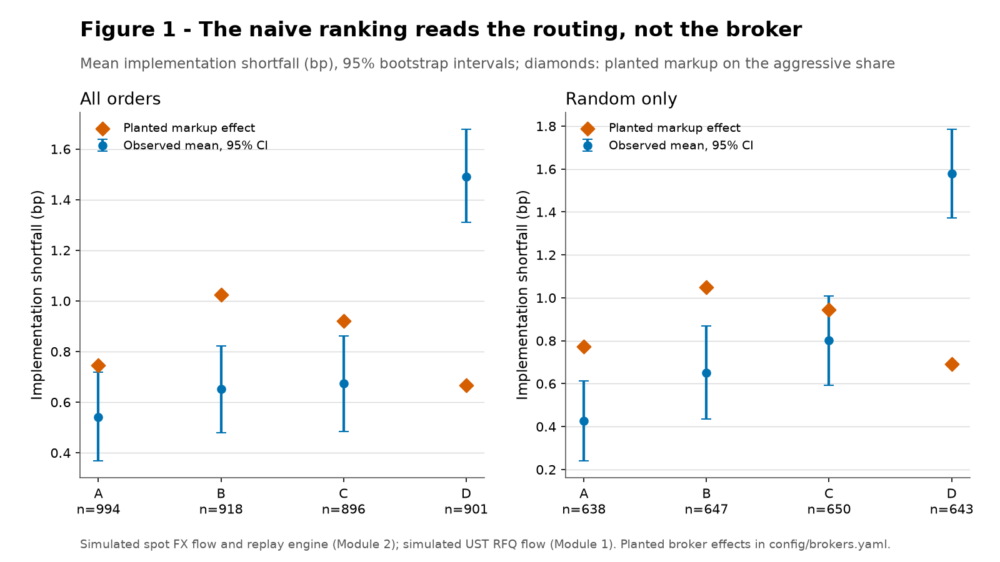
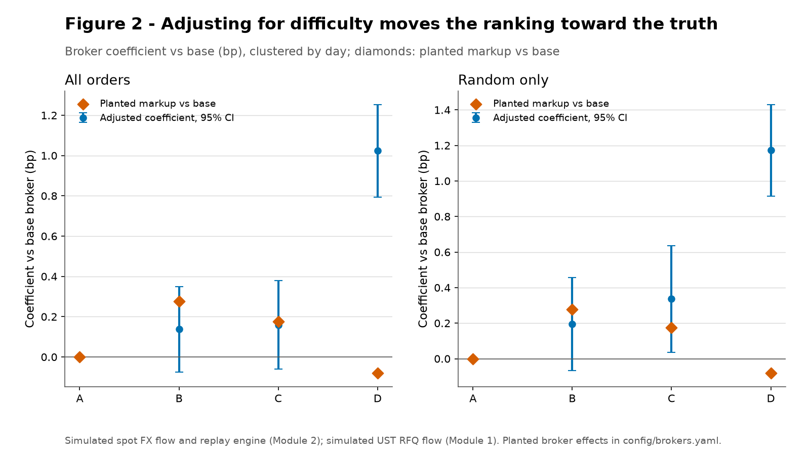
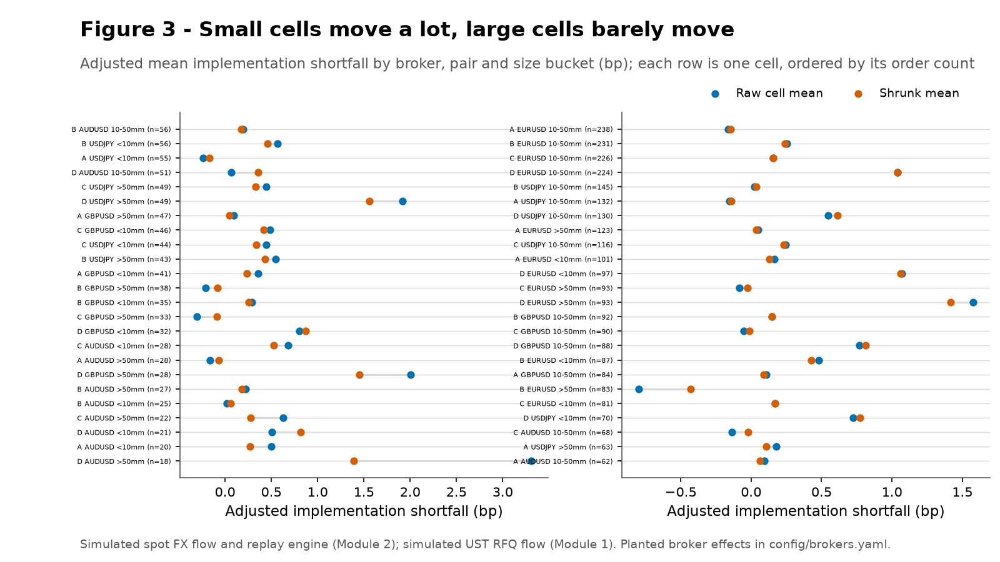
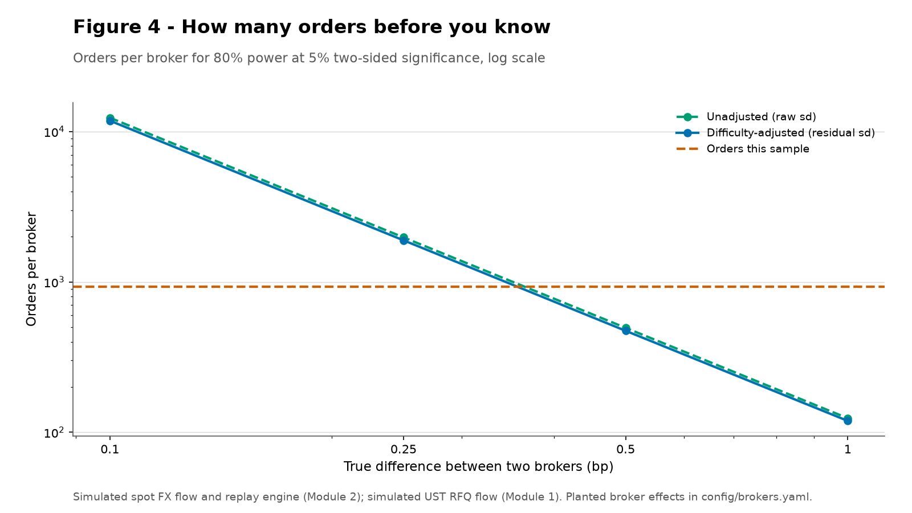
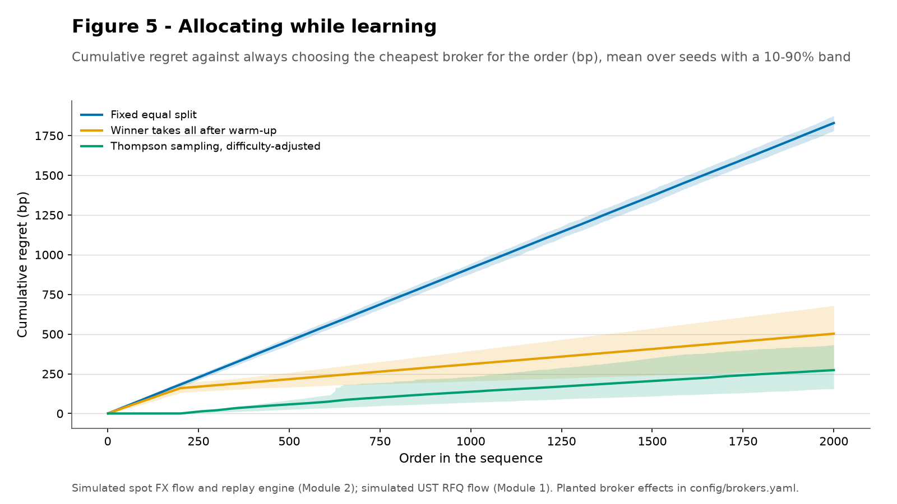

# Note 1: Ranking brokers, algos and dealers honestly

This note asks how far a broker ranking built on realised flow is from the truth, what fixes it,
how many orders it takes to tell two brokers apart, and what learning while allocating costs. The
flow is simulated, so the true effects are known: 3,709 Module 2 FX parent orders in <!-- results: meta.orders=3709 -->
TWAP, POV and IS style over 63 trading days (2025-03-03 to <!-- results: meta.trading_days=63; meta.period_start=2025-03-03 -->
2025-05-30), four brokers with markup, size sensitivity and post-fill leakage planted in <!-- results: meta.period_end=2025-05-30 -->
config/brokers.yaml; the point is the method, not the market.

## Summary

- **The naive ranking reads the routing.** A's mean implementation shortfall is
  0.541 bp over all orders but 0.426 bp on random flow, because <!-- results: naive.all.A.mean=0.541; naive.random.A.mean=0.426 -->
  discretionary routing sends A the large orders. B barely moves (0.651 against <!-- results: naive.all.B.mean=0.651 -->
  0.652); C rises from 0.673 to 0.802. <!-- results: naive.random.B.mean=0.652; naive.all.C.mean=0.673; naive.random.C.mean=0.802 -->
- **Adjustment recovers the large planted effects and nothing smaller.** D's leakage is
  1.024 bp (95% interval 0.794 to <!-- results: regression.brokers.D.coef=1.024; regression.brokers.D.lo=0.794 -->
  1.254); B's and C's penalties have the planted sign <!-- results: regression.brokers.D.hi=1.254 -->
  (0.137 and 0.159 bp) but neither is separated <!-- results: regression.brokers.B.coef=0.137; regression.brokers.C.coef=0.159 -->
  from zero. A's size penalty shows: -0.264 bp per log <!-- results: interaction_summary.size_slope_B_minus_A=-0.264 -->
  point steeper than B (SE 0.125). <!-- results: interaction_summary.size_slope_B_se=0.125 -->
- **Only large differences are settleable.** At 321 orders per <!-- results: meta.orders_per_broker_month=320.744 -->
  broker per month, a 0.25 bp difference takes 5.9 months and a <!-- results: power_summary.months_0_25=5.896 -->
  0.10 bp difference 36.8. Winner-takes-all locks in a non-best <!-- results: power_summary.months_0_1=36.842 -->
  broker on 62.5% of seeds and costs 0.251 bp per <!-- results: learning.wta_wrong_lock_fraction=0.625; learning.wta_bp=0.251 -->
  order; Thompson sampling costs 0.137. <!-- results: learning.ts_bp=0.137 -->

## 1. Why the naive ranking misleads

The left panel counts every order, the right panel only randomly assigned ones. A is cheapest in
the full book at 0.541 bp, then B at 0.651 and C at <!-- results: naive.all.A.mean=0.541; naive.all.B.mean=0.651 -->
0.673. That ordering is mostly assignment: orders above $100mm go preferentially <!-- results: naive.all.C.mean=0.673 -->
to A, whose impact multiplier is 1.30. On random flow A <!-- results: table1_by_broker.A.impact_multiplier=1.300 -->
improves to 0.426 bp, B stays at 0.652 and C rises to <!-- results: naive.random.A.mean=0.426; naive.random.B.mean=0.652 -->
0.802, so the apparent A-to-B gap of 0.110 bp understates <!-- results: naive.random.C.mean=0.802; naive_gaps.all_B_minus_A=0.110 -->
A's advantage by 0.115 bp. <!-- results: naive_gaps.all_A_minus_random_A=0.115 -->

Every 95% interval in the left panel spans about 0.352 bp, so differences among <!-- results: naive_width.all.A=0.352 -->
A, B and C sit at the edge of what this sample can see. D is the exception at
1.492 bp: its spread markup is the best of the four <!-- results: naive.all.D.mean=1.492 -->
(-0.250 bp), but its providers leak <!-- results: table1_by_broker.D.markup_bp=-0.250 -->
0.300 bp of permanent impact after each fill, and with <!-- results: table1_by_broker.D.post_fill_impact_bp=0.300 -->
11.068 fills per parent that dominates. <!-- results: meta.mean_fills=11.068 -->

## 2. Adjusting for difficulty

Table 2 regresses IS on log size relative to the pair's daily volume, trailing volatility, the
arrival half-spread, four hour buckets, pair, style and broker dummies with A as base, clustered
by day.

| Term | Coefficient (bp) | Clustered SE | p | 95% interval |
|---|---|---|---|---|
| Intercept | +4.464 | 1.862 | 0.0165 | +0.815 to +8.113 |
| C(hour_bucket)[T.london] | -0.176 | 0.141 | 0.2117 | -0.453 to +0.100 |
| C(hour_bucket)[T.overlap] | +0.031 | 0.227 | 0.8907 | -0.413 to +0.476 |
| C(hour_bucket)[T.pre] | -0.058 | 0.193 | 0.7659 | -0.436 to +0.321 |
| C(pair)[T.EURUSD] | -0.414 | 1.230 | 0.7366 | -2.824 to +1.997 |
| C(pair)[T.GBPUSD] | -0.578 | 1.136 | 0.6106 | -2.804 to +1.648 |
| C(pair)[T.USDJPY] | -0.563 | 1.271 | 0.6576 | -3.054 to +1.927 |
| C(style)[T.POV] | -0.652 | 0.087 | 0.0000 | -0.822 to -0.482 |
| C(style)[T.TWAP] | -0.096 | 0.130 | 0.4621 | -0.351 to +0.160 |
| C(broker)[T.B] | +0.137 | 0.108 | 0.2027 | -0.074 to +0.349 |
| C(broker)[T.C] | +0.159 | 0.112 | 0.1566 | -0.061 to +0.378 |
| C(broker)[T.D] | +1.024 | 0.117 | 0.0000 | +0.794 to +1.254 |
| log_size_rel | +0.297 | 0.054 | 0.0000 | +0.191 to +0.402 |
| sigma_d_bp | -0.001 | 0.004 | 0.7280 | -0.009 to +0.006 |
| hs_bp_at_arrival | -0.442 | 2.141 | 0.8366 | -4.639 to +3.755 |

n = 3709, R-squared = 0.044.

The fit explains little - R-squared 0.044, residual sd 2.744 bp <!-- results: regression.r2=0.044; regression.resid_sd=2.744 -->
against 2.806 raw - so the coefficients are small means in a noisy cross-section. D's 1.024 bp <!-- results: regression.raw_sd=2.806; regression.brokers.D.coef=1.024 -->
(0.794 to 1.254) is the largest effect; B's is <!-- results: regression.brokers.D.lo=0.794; regression.brokers.D.hi=1.254 -->
0.137 (-0.074 to 0.349) and <!-- results: regression.brokers.B.coef=0.137; regression.brokers.B.lo=-0.074; regression.brokers.B.hi=0.349 -->
C's 0.159 (-0.061 to <!-- results: regression.brokers.C.coef=0.159; regression.brokers.C.lo=-0.061 -->
0.378), both positive and neither distinguishable from zero or each other. <!-- results: regression.brokers.C.hi=0.378 -->
Random-only coefficients are in Figure 2 and results.json: C excludes zero there, but a panel
chosen after seeing the data is the least trustworthy version.

The interaction fit adds broker-by-size and broker-by-session terms. A's cost rises
0.337 bp per log point; B's slope is <!-- results: interaction_summary.size_slope_base=0.337 -->
-0.264 flatter (SE 0.125) <!-- results: interaction_summary.size_slope_B_minus_A=-0.264; interaction_summary.size_slope_B_se=0.125 -->
and C's -0.164, so A's planted size penalty is recovered. <!-- results: interaction_summary.size_slope_C_minus_A=-0.164 -->
C's session effect is not: its spread component falls by 0.295 bp inside the <!-- results: window_spread.C_drop=0.295 -->
07:00-12:00 UTC window (0.488 to 0.194; A: <!-- results: window_spread.C_outside=0.488; window_spread.C_inside=0.194 -->
0.165 to 0.146), but the C-minus-A total contrast is <!-- results: window_spread.A_outside=0.165; window_spread.A_inside=0.146 -->
0.060 bp (SE 0.265). <!-- results: interaction_summary.session_C_minus_A=0.060; interaction_summary.session_C_se=0.265 -->

## 3. Small samples and shrinkage

Desks also rank pair by pair and size bucket by size bucket: 48 cells, from
18 to 238 orders. Figure 3 shrinks each cell's adjusted <!-- results: shrinkage.smallest_n=18; shrinkage.largest_n=238 -->
mean toward its broker's mean, theta_hat = (n xbar / s2 + mu / tau2) / (n / s2 + 1 / tau2), with
tau2 = 0.287 by method of moments. <!-- results: shrinkage.tau2=0.287 -->

The smallest third of cells moves 0.281 bp on average, the largest third <!-- results: shrinkage.small_n_move=0.281 -->
0.031 bp (Spearman correlation between absolute move and n: <!-- results: shrinkage.large_n_move=0.031 -->
-0.692). The most extreme cell is D in AUDUSD above $50mm: <!-- results: shrinkage.move_vs_n_spearman=-0.692 -->
18 orders, raw 3.310 bp shrunk to <!-- results: shrinkage.extremes.0.n=18; shrinkage.extremes.0.raw=3.310 -->
1.391. At the other end B in EURUSD above $50mm moves from <!-- results: shrinkage.extremes.0.shrunk=1.391 -->
-0.799 to -0.428 on <!-- results: shrinkage.extremes.2.raw=-0.799; shrinkage.extremes.2.shrunk=-0.428 -->
83 orders. Small cells should not be ranked on raw means: the smallest has <!-- results: shrinkage.extremes.2.n=83 -->
a standard error of 1.225 bp. <!-- results: shrinkage.smallest_se=1.225 -->

## 4. How long until you know

Figure 4 converts the residual sd into orders per broker for 80% power at 5% two-sided
significance.

| Effect to detect (bp) | Orders per broker, unadjusted | Orders per broker, difficulty-adjusted | Months at this desk's flow |
|---|---|---|---|
| 0.1 | 12,358 | 11,817 | 36.84 |
| 0.25 | 1,978 | 1,891 | 5.90 |
| 0.5 | 495 | 473 | 1.47 |
| 1 | 124 | 119 | 0.37 |

At 927 orders per broker, or 321 per <!-- results: meta.orders_per_broker=927; meta.orders_per_broker_month=320.744 -->
month, a 0.25 bp difference takes 5.9 months and a 0.10 bp <!-- results: power_summary.months_0_25=5.896 -->
difference 36.8. Adjustment barely helps: residual sd <!-- results: power_summary.months_0_1=36.842 -->
2.744 bp against 2.806 raw cuts the requirement by <!-- results: regression.resid_sd=2.744; regression.raw_sd=2.806 -->
4.4%, because it removes composition bias, not market noise. This sets the <!-- results: power_gain_0_1=0.044 -->
review cadence, and it says quarterly near a tenth of a bp.

## 5. Allocating while learning

Figure 5 simulates 2,000 sequential orders and compares a fixed equal split, winner-takes-all on
the naive mean after 200 orders, and Thompson sampling on the difficulty-adjusted residual,
refitted every 50 orders. Regret is cumulative bp against always choosing the cheapest broker,
over 200 seeds. <!-- results: learning.seeds=200 -->

The equal split pays 0.915 bp per order and never learns. Winner-takes-all <!-- results: learning.equal_split_bp=0.915 -->
pays 0.251 and locks in a non-best broker on 62.5% of <!-- results: learning.wta_bp=0.251; learning.wta_wrong_lock_fraction=0.625 -->
seeds, because 200 orders of discretionary flow leave A looking worse than it is. Thompson
sampling pays 0.137 and beats winner-takes-all on <!-- results: learning.ts_bp=0.137 -->
86.5% of seeds; it settles at 48.9% to A, <!-- results: learning.ts_below_wta_fraction=0.865; learning.ts_share.A=0.489 -->
31.0% to C and 17.0% to B, the rest to D. <!-- results: learning.ts_share.C=0.310; learning.ts_share.B=0.170 -->

That split is the honest result: the A-to-C gap is 0.079 bp, inside the <!-- results: learning.gap_C_minus_A=0.079 -->
noise 2,000 orders can resolve, so the sampler keeps exploring. The cost is bounded but real: reallocating on
200 orders of naive means locks in a composition bias rather than learning.

## 6. The same idea for dealers

Table 3 applies it to RFQ hit rates and the winning dealer's margin: a logit of winning on size,
tenor, run status, dealer count and hour with dealer fixed effects, clustered by parent order,
plus an OLS of the winner's margin over cover in 32nds. There are 20,577 <!-- results: dealers.n_responses=20577 -->
responses and 5,414 wins. <!-- results: dealers.n_wins=5414 -->

| Dealer | Wins | Responses | Hit rate | Hit effect (logit) | SE | Margin effect (32nds) | SE |
|---|---|---|---|---|---|---|---|
| D01 | 685 | 2,382 | 0.288 | +0.000 | - | +0.000 | - |
| D02 | 925 | 2,192 | 0.422 | +0.614 | 0.071 | -0.003 | 0.009 |
| D03 | 440 | 2,428 | 0.181 | -0.616 | 0.076 | +0.022 | 0.013 |
| D04 | 663 | 2,009 | 0.330 | +0.222 | 0.073 | +0.016 | 0.009 |
| D05 | 529 | 1,828 | 0.289 | -0.008 | 0.076 | -0.008 | 0.009 |
| D06 | 651 | 1,670 | 0.390 | +0.490 | 0.077 | +0.005 | 0.011 |
| D07 | 390 | 1,585 | 0.246 | -0.223 | 0.081 | -0.042 | 0.011 |
| D08 | 451 | 1,742 | 0.259 | -0.165 | 0.078 | +0.026 | 0.011 |
| D09 | 302 | 1,857 | 0.163 | -0.741 | 0.085 | -0.001 | 0.014 |
| D10 | 100 | 912 | 0.110 | -1.248 | 0.119 | -0.042 | 0.014 |
| D11 | 179 | 1,065 | 0.168 | -0.740 | 0.105 | -0.041 | 0.011 |
| D12 | 99 | 907 | 0.109 | -1.257 | 0.119 | -0.040 | 0.019 |

The hit-rate spread is wide: D02 is 0.614 logit points <!-- results: dealers.max_hit_dealer=D02; dealers.max_hit_effect=0.614 -->
above the base dealer and D12 is -1.257 below. Margin <!-- results: dealers.min_hit_dealer=D12; dealers.min_hit_effect=-1.257 -->
effects are all inside 0.042 32nds, a fraction of the half-spread, so <!-- results: dealers.max_abs_margin_32nds=0.042 -->
the dealers who win most are not visibly paying up.

Hit rate alone is a bad metric: a dealer can win every RFQ by quoting through the market and
hedging the client's information - excellent hit rate, terrible markout. The margin column stops
that reading, and a markout column belongs beside it.

## 7. What this means on a real desk

- **Randomise a slice of flow and rank on it.** Ten to twenty per cent at random gives an
  unbiased comparison at a known cost.
- **Adjust before you rank.** Size, volatility, arrival spread, hour, pair and style all move
  cost; the adjustment is cheap once the data exist.
- **Publish intervals, not ranks.** A ranking with overlapping intervals is not a ranking.
- **Set the cadence from the power calculation.** At 321 orders <!-- results: meta.orders_per_broker_month=320.744 -->
  per broker per month, differences below 0.25 bp take more than two quarters. Reviewing monthly
  is reviewing noise.
- **Keep an audit of allocation changes.** Record each estimate, its interval and the date.

## Methods appendix

**Data.** fx_tca_parent, fx_orders and fx_liquidity_profile, restricted to TWAP, POV and IS
(3,709 orders). Planted truth is read from config/brokers.yaml at run time. Markup is <!-- results: meta.orders=3709 -->
charged on aggressive fills only, so 20.9% of notional carries none; the <!-- results: meta.passive_share=0.209 -->
realised markup is 0.79 of the configured value for A. <!-- results: planted_realised.A.aggressive_share=0.787 -->

| Broker | Markup (bp) | Time window | Impact multiplier | Leakage (bp/fill) | Realised markup (bp) |
|---|---|---|---|---|---|
| A | -0.15 | - | 1.30 | 0.00 | -0.118 |
| B | +0.20 | - | 1.00 | 0.00 | +0.158 |
| C | +0.25 | 07:00-12:00: -0.10 | 1.00 | 0.00 | +0.057 |
| D | -0.25 | - | 1.00 | 0.30 | -0.199 |

**Bootstrap.** 2,000 percentile resamples per broker and panel, seed 20250303. <!-- results: meta.seed=20250303 -->

**Regressions.** is_bp ~ log_size_rel + sigma_d_bp + hs_bp_at_arrival + C(hour_bucket) +
C(pair) + C(style) + C(broker), clustered by day. The interaction fit replaces hour buckets with
a quadratic hour trend (the session dummy is not identified next to its own bucket dummy) and
adds C(broker):log_size_rel and C(broker):london_morning. sigma_d_bp is annualised realised
volatility over sqrt(252); hs_bp_at_arrival is half the median spread in the arrival bucket.

**Shrinkage.** Normal-normal empirical Bayes on the 48 cells; tau2 by method of moments; mu the
broker's overall adjusted mean.

**Power.** stats.required_n: two-sample normal approximation, 80% power, 5% two-sided. Months
divides required orders per broker by 321. <!-- results: meta.orders_per_broker_month=320.744 -->

**Learning.** 2,000 orders per seed drawn with replacement; broker costs from <!-- results: learning.n_orders=2000 -->
the planted effects with the row's own cost differenced out; 200-order warm-up on actual
assignment; 200 seeds. Thompson sampling uses a normal posterior per broker <!-- results: learning.seeds=200 -->
(prior variance 1 bp^2) on the control-adjusted residual, refitted every 50 orders.

**Dealers.** ust_rfq_quotes, ust_rfq, ust_orders; responded quotes only; margin is side x
(cover - winning quote) x 32, positive when the client paid less than cover.

**Reproduce.** uv run python notes/04_algo_wheel/analysis.py writes results.json and
figures/; every number above carries its results.json key in an HTML comment.
uv run pytest tests/notes/test_algo_wheel.py -q runs the tests.

**Limitations.** Effects are planted and flow simulated; C's session effect is not identified
here. The power calculation assumes independent orders, so clustering by day makes the true
requirement larger.
