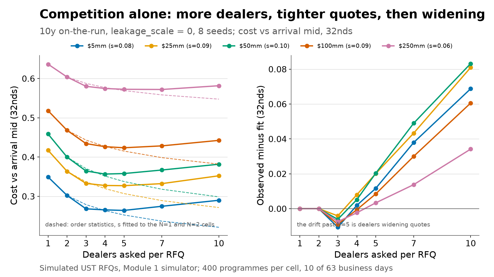
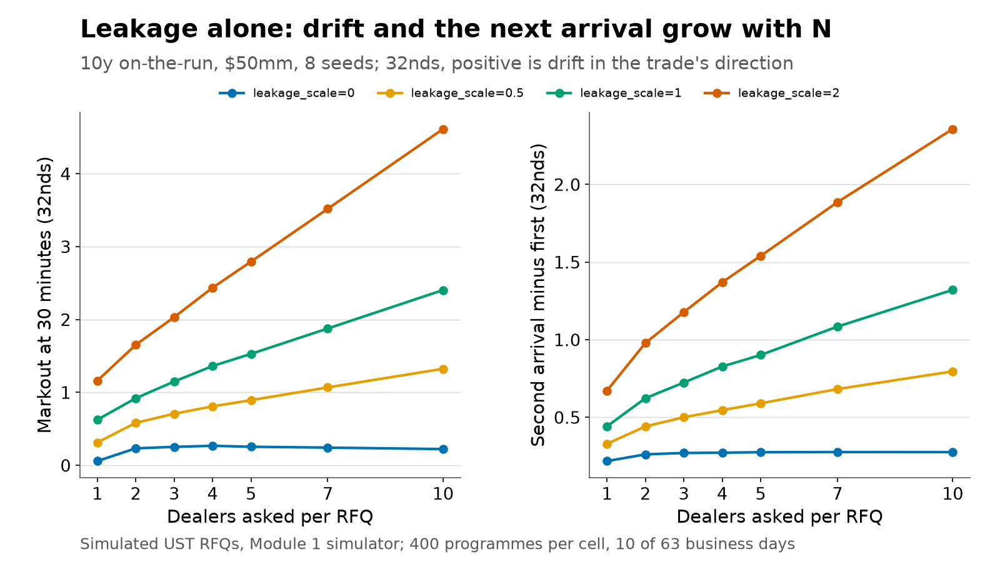
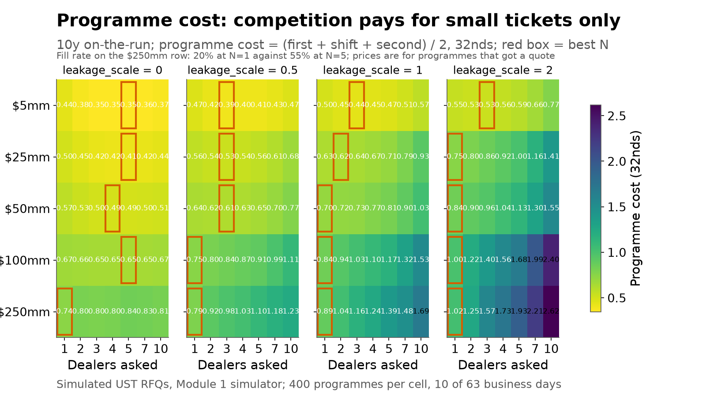
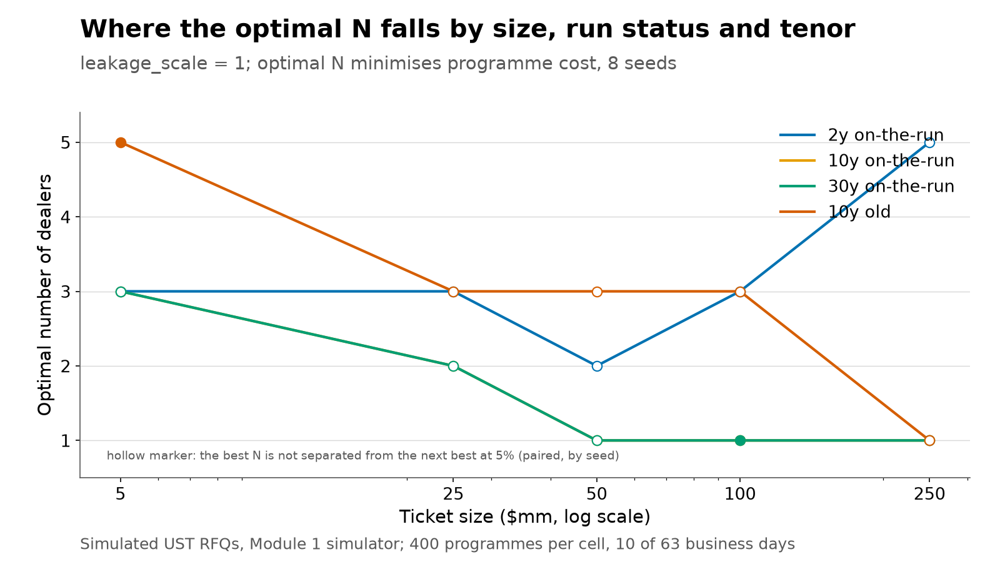

# How many dealers should you put in competition?

**Research note 3.** Querying more dealers improves the best quote through competition but tells more
people what you are doing; losing dealers hedge or reposition and the market moves against the rest of
your programme. This note measures both sides in the Module 1 UST RFQ simulator and maps the optimal
number of dealers by ticket size, run status and tenor.

Simulated data only: every number below comes from `analysis.py` in this folder, run on the committed
inputs of the Module 1 simulator (`config/ust_sim.yaml`). The leakage mechanism is a modelling
assumption, not an estimate from Treasury data.

## Summary

- **On a 10y on-the-run ticket at the default leakage (`leakage_scale = 1`), the programme-cost optimum
  is 3 dealers at $5mm, 2 at $25mm (1 and 2 are indistinguishable: 0.624 against 0.627 32nds), and one
  dealer at $100mm and above (0.843 against 0.944 at N = 2).**
- **The optimum drops below 3 between $5mm and $25mm and keeps falling with size; with leakage switched
  off the same experiment puts the optimum at 4-5 dealers for every size up to $100mm, so the whole size
  gradient comes from leakage.**
- **Using 5 dealers instead of 1 on a $250mm 10y ticket costs 0.50 32nds of programme cost (1.387 against
  0.886, +56%) — but the fill rate at one dealer on that size is 20% against 55% at five, so the cost
  alone overstates what one dealer buys you.**

| | 5mm | 25mm | 50mm | 100mm | 250mm |
|---|---|---|---|---|---|
| Best N, 10y on-the-run | 3 | 2 | 1 | 1 | 1 |
| Programme cost at the best N (32nds) | 0.439 | 0.624 | 0.703 | 0.843 | 0.886 |
| Best N, 10y on-the-run, leakage off | 5 | 5 | 4 | 5 | 1 |
| Fill rate at N = 1 | 86% | 81% | 75% | 59% | 20% |

## 1. The trade-off

Baldauf and Mollner (*Competition and Information Leakage*, Journal of Political Economy, 2024) show
that in a request-for-quote market more contacts intensify both competition and leakage: each additional
dealer tightens the best quote, and each additional losing dealer learns something about the client's
direction. Their model also says a client reveals nothing about direction, which is why the cost of
leakage falls on the client's *subsequent* orders, not on the order being worked. The industry evidence
on that second channel is from credit: Tradeweb's note on information leakage in all-to-all credit RFQs
(2026) documents dealers widening and hedging after losing a large RFQ. There is no public intraday
Treasury RFQ tape to measure the same thing, which is why this note runs the experiment in the Module 1
simulator and says plainly where the mechanism is assumed.

The design follows that logic. Every programme sends two RFQs of the same size, side and security
20 minutes apart. The first RFQ measures the competition benefit (its cost against the arrival mid);
the second measures the leakage cost, as the signed move of its arrival mid relative to the first
RFQ's arrival; the programme cost is `(exec_cost_1 + arrival_shift_2 + exec_cost_2) / 2`.

## 2. Competition benefit alone

With `leakage_scale = 0` (left panel), the cost against the arrival mid falls steeply from one dealer
to about four and then flattens: at $50mm, 0.459 (N = 1), 0.400 (N = 2), 0.364 (N = 3), 0.357 (N = 4),
0.357 (N = 5), 0.367 (N = 7), 0.382 (N = 10). The dashed lines are the order-statistics benchmark: if
dealer premia were iid normal around a common centre with dispersion `s`, the expected best of N would
improve by `s * E[max of N standard normals]` (0, 0.56, 0.85, 1.03, 1.16, 1.35 and 1.54 32nds for
N = 1, 2, 3, 4, 5, 7, 10). Fitting `s` to the N = 1 and N = 2 cells gives 0.083, 0.095, 0.104, 0.089 and
0.058 32nds for $5mm to $250mm; the benchmark then tracks N = 3 and N = 4 closely and under-predicts
cost from N = 5 on. The gap (right panel) is the dealers' competition widening (0.03 32nds per dealer
beyond three in the configuration): it adds about 0.02 32nds by N = 5 and 0.06 to 0.10 by N = 10, which
is the flattening the literature describes. The order-statistics constants are computed by numerical
integration in `analysis.py` and checked against `scipy` in the tests.

## 3. Leakage alone

Both leakage measures are close to linear in N - 1 and scale with `leakage_scale`. For a $50mm 10y
on-the-run ticket at `leakage_scale = 1`, the markout 30 minutes after the first RFQ rises from 0.62
(N = 1) to 2.40 32nds (N = 10), and the second RFQ's arrival shift rises from 0.44 to 1.32 32nds.
Doubling the leakage parameter roughly doubles both slopes (1.16 to 4.61 and 0.67 to 2.36); switching
it off leaves a flat 0.06 to 0.22 32nds of markout and 0.22 to 0.28 of arrival shift, which is the
programme's own impact propagating to the next ticket.

Sign convention matters here. In this simulator every hedge is executed in the direction of the
client's trade, so the drift is *in the trade's direction*: a positive markout means the filled ticket
looks better ex post, and the cost shows up as a worse arrival on the next RFQ. The executed ticket's
markout on its own is therefore a misleading leakage metric; the pair is what carries the cost. The
same asymmetry is why the leakage numbers in this note are not comparable with a desk's adverse-selection
markouts, which typically come out negative.

## 4. Putting them together: the optimal N

Programme cost over N and size, one panel per leakage level (10y on-the-run, 8 seeds, 400 programmes
per cell). The red box is the best N in each row. At `leakage_scale = 0` the optimum sits at 4-5 dealers
for every size up to $100mm; as leakage rises it collapses towards one dealer for large tickets and
stays at 2-3 for small ones. At the default leakage the row minimum moves from N = 3 at $5mm to N = 1
from $100mm, and by $250mm one dealer costs 0.886 against 1.387 at five dealers and 1.690 at ten.

The same optimum across segments at the default leakage: 2y and 30y on-the-run, and 10y off-the-run.
Hollow markers are cells where the best N is not separated from the next best at 5% (paired by seed,
t-test on the per-seed differences). The long end and the front end do not behave the same way, and the
reason is in the calibration: the simulated price impact per $100mm rises from 0.15 32nds at 2y to 0.80
at 10y and 1.40 at 30y, so the same $250mm ticket produces far more hedge impact in the long end. At
$250mm the optimum is 5 dealers at 2y, 1 at 10y and 1 at 30y (the 30y cell is a tie); off-the-run
tickets sit at 3 dealers for most sizes because their wider spread makes competition worth more relative
to the leakage they generate.

Two caveats belong with the picture. First, most of the cells in the $25-50mm range are ties: the
difference between the best and second-best N is within the paired 5% band. The threshold between "3"
and "1-2" is the part the data supports. Second, programme cost is measured on programmes that got a
quote; at $250mm the fill rate is 20% at N = 1 and 55% at N = 5, so the one-dealer optimum at large
sizes is only attractive if an unfilled $250mm order is cheap, which this note does not price.

## 5. Axe trades

Table 1 compares a single-dealer trade restricted to a dealer with a favourable axe with three
unrestricted dealers, same sizes, 10y on-the-run, leakage 1, 8 seeds. `axe_share` is the fraction of
programmes whose first RFQ found a favourable axe; the metrics cover those programmes only.

| size | axe share | axe exec | axe markout 30m | axe programme | one exec | one programme | comp exec | comp markout 30m | comp programme |
|---|---|---|---|---|---|---|---|---|---|
| $5mm | 74% | 0.270 | 0.115 | 0.342 | 0.350 | 0.496 | 0.269 | 0.295 | 0.439 |
| $25mm | 73% | 0.336 | 0.956 | 0.753 | 0.417 | 0.627 | 0.331 | 1.005 | 0.641 |
| $50mm | 74% | 0.372 | 1.055 | 0.748 | 0.457 | 0.703 | 0.362 | 1.149 | 0.727 |
| $100mm | 74% | 0.453 | 1.642 | 1.029 | 0.518 | 0.843 | 0.432 | 2.079 | 1.028 |
| $250mm | 73% | 0.573 | 2.425 | 1.117 | 0.635 | 0.886 | 0.582 | 2.899 | 1.161 |

`one` is a single random dealer with no axe restriction (the N = 1 grid cell): what a desk without an
axe gets for the same ticket. An axe is worth 0.06 to 0.09 32nds of execution cost against that
benchmark, about as much as adding two competing dealers, and it is the reason a single-dealer axe
trade at $5mm matches three-dealer competition (0.270 against 0.269). On programme cost the picture is
mixed: the axe wins at $5mm (0.342 against 0.439 for three dealers) and at $250mm (1.117 against
1.161), is level at $100mm, and loses in the middle of the curve ($25mm: 0.753 against 0.641; $50mm:
0.748 against 0.727). So the specification's expectation — a good axe beats competition for large
tickets — holds at the top size but only by 0.04 32nds, and both single-dealer variants sit far above
the N = 1 random dealer at the same sizes.

The mechanism is in the table: at N = 1 the winner still hedges 30-80% of the ticket (one minus its
internalisation), and that hedge is the larger part of the leakage. An axe removes the losing dealers'
hedging, not the winner's. A desk keeps
axe data and dealer relationships for reasons this simulation does not model: fill certainty, the
information in the axe itself, and the risk that a dealer stops showing axes to a client who always
runs large competitions.

## 6. What to measure on your own flow

Table 2 lists, for each quantity in the model, the fields a desk needs in its own RFQ data, and the
sample size per cell to detect an effect of 0.10, 0.25 or 0.50 32nds (0.3, 0.8 and 1.6 bp of price) at
80% power and 5% two-sided, using the simulated pair-level residual as a stand-in for the desk's own
noise (two-sample formula, `n = 2 * (1.96 + 0.84)^2 * sd^2 / delta^2`).

| quantity | fields needed | residual sd (32nds) | n at 0.10 | n at 0.25 | n at 0.50 |
|---|---|---|---|---|---|
| Competition benefit | N asked, number of responses, best quote at each N | 0.36 | 201 | 33 | 9 |
| Post-trade drift | arrival mid, mid at 5 and 30 minutes after the award | 3.48 | 19,010 | 3,042 | 761 |
| Arrival shift of repeat RFQs | send timestamp, arrival mid, side and size of every repeat RFQ | 3.48 | 19,010 | 3,042 | 761 |
| Programme cost | all of the above, plus a programme identifier | 1.77 | 4,923 | 788 | 197 |

The practical reading: a desk can establish a competition effect on a few hundred RFQs, but proving a
leakage effect on its own flow needs thousands of paired repeat RFQs per cell — which is why the
industry evidence on leakage is cross-sectional and from credit. The residual standard deviations are
for a $50mm 10y on-the-run ticket at the default leakage; they should be recomputed per desk.

## 7. Limitations

- **The leakage mechanism is assumed.** Hedges are executed by the winning dealer (its un-internalised
  share) and by a random subset of losers, all in the direction of the client's trade, over windows of
  seconds to minutes. Nothing here estimates how much a real dealer hedges or how fast.
- **A positive markout is not evidence of no leakage.** Because hedges run with the client's trade, the
  executed ticket's markout is positive by construction; the cost appears on the next RFQ. A desk that
  measures only markouts will understate leakage.
- **Dealer behaviour is stylised.** Widening is linear in the number of dealers beyond three; response
  probabilities and internalisation are drawn once per dealer and never updated; there is no all-to-all
  channel and no relationship effect (dealers punishing clients who always run large competitions is not
  modelled). There is also no dealer learning across days.
- **Programme cost is conditional on trading.** It is measured on programmes that got a quote, and it
  excludes the opportunity cost of the RFQs that did not fill. At $250mm the fill rate at one dealer is
  20%, so the one-dealer optimum overstates what one dealer is worth in practice.
- **The public evidence is from credit, not Treasuries.** The Tradeweb note describes all-to-all credit
  RFQs; Treasuries are a different market with different hedging instruments.
- **Ten sampled days.** The grid spreads 400 programmes over 10 of the 63 business days of March-May
  2025, evenly spaced, so the intraday and regime structure is averaged over but not fully sampled.

## 8. Methods appendix

`analysis.py` uses `tca.ust.simulate.run` as a library. Each cell is one simulator run with an explicit
RFQ list and the dealer-policy override `n_dealers`, so every dealer asked is one of the configured
twelve and every RFQ in the cell uses the grid's N.

- Grid: `n_dealers` in {1, 2, 3, 4, 5, 7, 10} x size in {$5, 25, 50, 100, 250}mm x run status
  {on-the-run, old} x `leakage_scale` in {0, 0.5, 1, 2} x tenor {2y, 10y, 30y} = 840 cells.
- 400 programmes per cell, each a first RFQ and a second of the same size and side 20 minutes later
  in the same security, so 800 RFQs per run; first sends uniform between 09:30 and 14:30 New York.
- Ten business days sampled evenly from 2025-03-03 to 2025-05-30 (every sixth day); the RFQ schedule
  is identical across cells of the same size and segment (common random numbers).
- Eight seeds (20250303 to 20250310), 3,400 runs per worker, 6,800 runs in total: 6,720 grid runs and
  80 axe runs. Seeds are fixed, not resampled per cell.
- Run time: 47 minutes wall clock on two processes (arm64 VM, 6 cores shared with other work), 1,129 s
  for the first three seeds and 1,692 s for the remaining five; about 0.9 s per run on each worker.
- Reproduce: `uv run python notes/06_rfq_dealer_count/analysis.py` redraws the figures and tables from
  the committed `tables/grid_runs.csv`; add `--run --part k --parts m` then `--collect` to recompute the
  grid. Nothing in this note reads the sealed holdout.

Tests: `tests/notes/test_rfq_dealer_count.py` checks the three invariants on a reduced grid (N in
{1, 3, 7}, 10y on-the-run, one seed): execution cost falls with N when leakage is off, the second RFQ's
arrival shift rises with N at `leakage_scale = 2`, and the order-statistics constants match numerical
integration of the normal order statistic to two decimals.
